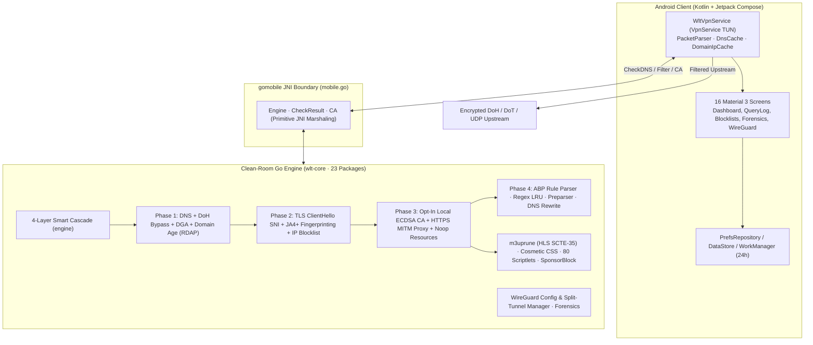

# WLT-AdBlocker — System Architecture

> **Proprietary IP Asset** — Copyright (c) 2026 Kushal (`@onlykushalll`). All Rights Reserved.  
> Technical due diligence & acquisition inquiries: `creatormanager27@gmail.com`

---

## 1. High-Level Topology

WLT-AdBlocker is a **rootless, zero-telemetry Android network protection platform** combining a **Kotlin + Jetpack Compose UI/VPN shell (`android/`)** with a **clean-room 23-package Go core engine (`wlt-core/`)** compiled to native ARM/x86 JNI libraries (`wlt.aar` via `gomobile bind`).



---

## 2. Package Breakdown (`wlt-core/`)

`wlt-core` (`github.com/wlt/adblocker`, Go 1.25+) is an **original clean-room Go implementation** depending solely on the Go standard library and `golang.org/x/mobile` (BSD-3-Clause) — **zero GPL-3.0 third-party filter engines (`AdguardTeam/urlfilter`, `firestack`) are linked**.

| Package | Role |
|---|---|
| `mobile.go` (root) | `gomobile` C/JNI boundary (`Engine`, `CheckResult`, CA lifecycle) |
| `engine/` | Orchestrates the 4-layer smart cascade and allowlist overrides |
| `dns/` | RFC 1035 parser generating synthetic `NXDOMAIN`, `0.0.0.0`, `::`, `NODATA`, `REFUSED` |
| `filter/` | Asset loader, host/domain compilers, list updater |
| `net/` | TLS ClientHello SNI extractor and hardcoded SDK IP matcher |
| `internal/trie/` | Thread-safe (`RWMutex`) reversed-label domain suffix trie |
| `internal/bloom/` | Suffix-aware counting Bloom filter for fast negative lookups |
| `internal/gamesdk/` | Fingerprints for 12 mobile game ad SDKs (AdMob, Unity, AppLovin, etc.) |
| `internal/ja4/` | JA4+ TLS handshake fingerprinting for SDK evasion |
| `internal/dga/` | Shannon entropy + n-gram + vowel/digit DGA detector |
| `internal/domainage/` | Async RDAP registrar age lookup (blocks newly registered domains) |
| `internal/ruleparser/` | ABP/uBlock filter syntax parser (`$important`, `$badfilter`, `$dnstype`) |
| `internal/preparser/` | Directive preprocessor (`!#if`, `!#else`, `!#endif`, `!#include`) |
| `internal/dnsrewrite/` | AdGuard-compatible DNS rewrite engine + SafeSearch enforcement |
| `internal/mitm/` & `httpsproxy/` | Opt-in local ECDSA P-256 CA + per-domain cert minting + noop assets |
| `internal/scriptlets/` & `cosmetic/` | 80 anti-adblock/privacy scriptlets + CSS/procedural DOM filters |
| `internal/m3uprune/` & `sponsorblock/` | HLS playlist ad-segment stripper & SponsorBlock client |
| `internal/forensics/` | Per-miss diagnostic analyzer ("why did an ad slip through?") |
| `internal/wireguard/` | Pure-Go WireGuard configuration parser & tunnel state manager |
| `cmd/` | CLI/diagnostic harness entry point |

---

## 3. Android Client (`android/`)

- **UI Layer (`ui/screens/`):** 16 Jetpack Compose screens built with Material 3 (`DashboardScreen`, `QueryLogScreen`, `BlocklistsScreen`, `CustomRulesScreen`, `AppFirewallScreen`, `DnsLatencyScreen`, `ForensicsScreen`, `SettingsScreen`, `OnboardingScreen`, `PauseProtection`, `BlockedServicesScreen`, `AppAnalyticsScreen`, `RegexRulesScreen`, `BatteryOptimizationScreen`, `WireGuardScreen`, `DiagnosticScreen`).
- **VPN & Packet Pipeline (`vpn/`):** `WltVpnService` establishes a local TUN interface via `VpnService.Builder` (no root required), maintains an in-memory LRU query cache, resolves per-UID ownership via `ConnectivityManager`, and delegates classification to `wlt.aar` (with Kotlin fallback engine).
- **Local-Only Privacy Posture:** Zero remote telemetry, zero cloud proxying, and RAM-only query logs (wiped on restart or cleared manually).

---

## 4. Build & Verification Matrix

```bash
# 1. Verify Go engine (22 test suites + static analysis)
cd wlt-core
go test ./... -count=1
go vet ./...

# 2. Rebuild JNI .aar (optional; prebuilt binary already committed in android/app/libs/wlt.aar)
gomobile bind -target=android/arm64,android/arm,android/386,android/amd64 -androidapi=21 -o ../android/app/libs/wlt.aar .

# 3. Build Android APK & run JVM unit tests
cd ../android
./gradlew :app:testDebugUnitTest
./gradlew :app:assembleDebug
```
