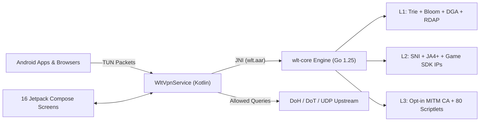

# WLT-AdBlocker

> Privacy-first, rootless commercial Android ad & tracker blocker powered by a clean-room 23-package Go core engine.  
> No root required. No cloud proxy. No telemetry. No accounts.

[](LICENSE.md)
[](#testing)
[](#requirements)
[](#building-from-source)
[](#scriptlets)
[](#blocklists)

---

## Executive Overview & Value Proposition

**WLT-AdBlocker** is an IP-clean, on-device Android network privacy and ad-blocking platform pairing a **Kotlin + Jetpack Compose application (16 screens)** with a **high-throughput Go filter engine (`wlt-core`, compiled via `gomobile` to native `arm64`/`arm`/`x86`/`x86_64` JNI libraries)**. Unlike open-source clones linked against GPL-3.0 engines (`AdguardTeam/urlfilter`), `wlt-core` is written clean-room in Go using only the Go standard library and BSD-3-Clause `golang.org/x/mobile` bindings — making it safe for commercial licensing, OEM white-labeling, or full IP acquisition.

## Features

### 4-Layer Smart Cascade
WLT uses an escalating 4-layer defense pipeline to block ads, trackers, CNAME cloaks, and game SDK telemetry while minimizing battery drain:

| Layer | Technique | Status |
|---|---|---|
| **Phase 1 — DNS Blocking** | Reversed-label Trie + Counting Bloom filter + Game SDK + DoH bypass + CNAME-cloak + DGA detection + Domain age (RDAP) | Active |
| **Phase 2 — SNI Inspection** | TLS ClientHello SNI extraction + JA4+ fingerprinting + hardcoded SDK IP lists | Active |
| **Phase 3 — HTTPS MITM** | Local CA (ECDSA P-256), per-domain cert minting, `m3u-prune`, 80 scriptlets, noop resources | Opt-in |
| **Phase 4 — Advanced** | Regex matching with LRU-bounded manager, ABP rule parser, preparser directives, DNS rewrite | Active |

### Key Capabilities

- **888 curated blocklist domains** across 10 asset files (`wlt-game-ads`, `wlt-trackers`, `wlt-smart-tv-ads`, `wlt-passthrough`, `wlt-youtube-ads`, `wlt-crypto-mining`, `wlt-social-ads`, `wlt-cname-cloak`, `wlt-spotify-ads`, `sources.json`)
- **80 scriptlets** covering uBlock-style, Brave `de-amp`, YouTube web, Spotify, Twitch, social feeds, crypto mining, and anti-fingerprinting
- **23 Go packages** (`wlt-core/`) compiled to `wlt.aar` (`arm64-v8a`, `armeabi-v7a`, `x86`, `x86_64`)
- **12 game SDK fingerprints** (AdMob, Unity, AppLovin, ironSource, Chartboost, Vungle, Meta, AdColony, Mintegral, Fyber, Tapjoy, InMobi)
- **Domain age verification** via async RDAP (flags newly registered domains) & **JA4+ TLS fingerprinting**
- **ABP/uBlock rule parser** (`$important`, `$badfilter`, `$dnstype`) & `!#if` preprocessor directives
- **DNS rewrite engine** (`NXDOMAIN`, `NullIP`, `REFUSED`, `NODATA`, `CNAME` + SafeSearch) & **LRU DNS cache**
- **Bypass prevention** (blocks DoT port 853, DoH provider domains, ECH config, opt-in QUIC fallback)
- **DGA detection** (Shannon entropy + n-gram + vowel/digit ratio)
- **Per-app firewall & analytics** (`VpnService.Builder.addDisallowedApplication`, per-UID tracking, reverse IP cache)
- **WireGuard tunnel manager**, **PCAP packet export**, optional **root hosts mode**, **5 protection tiers**, **pause timer**, **Quick Settings tile**
- **16 Jetpack Compose screens** (`Dashboard`, `QueryLog`, `Blocklists`, `CustomRules`, `AppFirewall`, `DnsLatency`, `Forensics`, `Diagnostic`, `Settings`, `Onboarding`, `PauseProtection`, `BlockedServices`, `AppAnalytics`, `RegexRules`, `BatteryOptimization`, `WireGuard`)

### Privacy & Clean-Room IP Guarantees

- **No root required** — Standard Android `VpnService` TUN interface
- **No cloud proxy** — 100% of packet inspection and DNS/SNI decisions happen on-device
- **Zero telemetry** — No remote crash reporting, analytics SDKs, or cloud logging
- **Clean-room Go engine** — Zero GPL-3.0 dependencies (`LICENSE.md` & `THIRD_PARTY` carve-outs verified)

## Architecture



See [`ARCHITECTURE.md`](ARCHITECTURE.md) for package-level internals and JNI boundaries.

## Requirements

- Android 8.0 (API 26) or later
- Go 1.25+ & Android NDK (only required when regenerating `wlt.aar`)
- Android SDK (API 35) & JDK 17 (Temurin recommended)

## Building from Source

```bash
# 0. Copy environment template (optional release signing / SDK paths)
cp .env.example .env

# 1. Run Go core engine tests & static checks
cd wlt-core
go test ./... -count=1
go vet ./...

# 2. (Optional) Rebuild wlt.aar native bindings
go install golang.org/x/mobile/cmd/gomobile@latest
go install golang.org/x/mobile/cmd/gobind@latest
gomobile init
gomobile bind -target=android/arm64,android/arm,android/386,android/amd64 \
  -androidapi=21 -o ../android/app/libs/wlt.aar .

# 3. Build Android APK & run unit tests
cd ../android
./gradlew :app:testDebugUnitTest
./gradlew :app:assembleDebug
```

> **Note on Windows WDAC:** If `gomobile`/`gobind` binaries trigger Windows Device Guard, build local aliases:  
> `go build -o wlt-gomobile.exe golang.org/x/mobile/cmd/gomobile`

## Project Structure

```
WLT-AdBlocker/
├── wlt-core/                    # Clean-room Go core engine (23 packages)
│   ├── mobile.go                # gomobile JNI bridge layer
│   ├── engine/                  # 4-layer Smart Cascade orchestrator
│   ├── dns/                     # RFC 1035 DNS synthesizer
│   ├── filter/                  # Blocklist loader & preparser
│   ├── net/                     # TLS ClientHello SNI & IP matching
│   └── internal/                # trie, bloom, gamesdk, forensics, mitm, httpsproxy,
│                                # scriptlets, cosmetic, m3uprune, sponsorblock, ja4,
│                                # dga, dnsrewrite, domainage, ruleparser, preparser, wireguard
├── android/                     # Android app (Kotlin + Jetpack Compose)
│   └── app/src/main/
│       ├── java/com/wlt/adblocker/
│       │   ├── vpn/             # WltVpnService, caches, RootMode
│       │   ├── filter/          # Kotlin fallback & blocklist manager
│       │   ├── data/            # RuleStore, QueryLog, stats, PcapExporter
│       │   └── ui/              # 16 Compose screens + Material 3 theme
│       └── assets/blocklists/   # 10 curated blocklist assets (888 domains)
├── docs/                        # Design research & historical architecture notes
├── ARCHITECTURE.md              # Due-diligence technical architecture overview
├── .env.example                 # SDK & signing configuration template
├── CHANGELOG.md                 # Version history
├── PRIVACY.md                   # Privacy policy (root standard mirror)
├── PRIVACY_POLICY.md            # Full privacy policy
├── TERMS.md                     # Commercial evaluation terms
├── ROADMAP.md                   # Feature roadmap
└── LICENSE.md                   # Proprietary Commercial Evaluation License + Carve-Out
```

## Blocklists

| File | Domains | Category |
|---|---|---|
| `wlt-game-ads.txt` | 202 | Game SDK ads + DoH bypass + ECH config |
| `wlt-trackers.txt` | 228 | Analytics + attribution + telemetry |
| `wlt-smart-tv-ads.txt` | 85 | Samsung/Roku/LG/Vizio ACR |
| `wlt-passthrough.txt` | 83 | Banking/gov allowlist |
| `wlt-youtube-ads.txt` | 83 | YouTube CSAI/SSAI/tracking |
| `wlt-crypto-mining.txt` | 75 | Mining pools + browser miners |
| `wlt-social-ads.txt` | 61 | TikTok/Snapchat/Twitch/Pangle |
| `wlt-cname-cloak.txt` | 50 | CNAME cloaking targets |
| `wlt-spotify-ads.txt` | 21 | Spotify ad/tracking |
| **Total** | **888** | |

## Honest Limitations

- **YouTube app ads** — Native app SSAI and cert pinning limit blocking to tracker telemetry; browser playback supports scriptlets/cosmetic filtering.
- **Spotify app / TikTok first-party feeds** — Server-side stitched or same-CDN streams cannot be separated cleanly at DNS level alone.
- **Certificate-pinned apps** — Opt-in Phase 3 HTTPS MITM applies only to non-pinned apps and excludes `wlt-passthrough.txt`.

## License & Commercial Inquiries

Copyright (c) 2026 Kushal (`@onlykushalll`). All Rights Reserved.  
This repository is a proprietary software asset available for commercial licensing, OEM white-labeling, technical due diligence, or full IP acquisition. See [`LICENSE.md`](LICENSE.md) for the **Third-Party Upstream Carve-Out** (Android SDK/Jetpack Compose under Apache-2.0, Go stdlib & `golang.org/x/mobile` under BSD-3-Clause; clean-room `wlt-core` contains zero GPL dependencies).

- **Commercial & M&A Contact:** `creatormanager27@gmail.com`
- **Privacy Policy:** [`PRIVACY.md`](PRIVACY.md) · [`PRIVACY_POLICY.md`](PRIVACY_POLICY.md) · **Terms:** [`TERMS.md`](TERMS.md)
